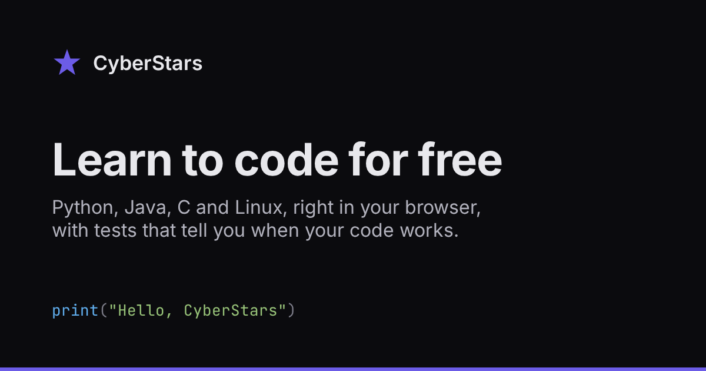

<p align="center">
  <a href="https://cyberstars.app"></a>
</p>

<p align="center">
  <a href="https://github.com/lauppv/cyberstars/actions/workflows/ci.yml"></a>
  <a href="LICENSE"></a>
  <a href="CONTRIBUTING.md"></a>
  <a href="https://cyberstars.app"></a>
</p>

# CyberStars

A free, open-source platform to learn Python, Java, C and Linux in your browser. Read a lesson, write code next to it, run it, and pass the lesson's tests to finish it.

Live at [cyberstars.app](https://cyberstars.app), in English and Romanian.

## Features

- **Five courses**: Python (60 lessons), Java (49), C (47), Linux in a real terminal (55) and Trees and Graphs (12, Beta, each lesson in all three languages)
- **88 algorithm challenges** from Easy to Hard, graded against hidden tests, with your runtime next to the reference solution
- **Split-screen lessons**: the lesson on the left, a live editor on the right, and every example in the text runnable
- **Graded, not honor-system**: a lesson counts as done only once the server's judge passes it
- **Step-by-step visuals** of arrays, linked lists, trees, graphs and stacks, some asking you to predict the next step
- **An AI tutor** that nudges you toward the answer without handing it over
- **Progress**: XP, levels, badges, a placement test, and Laniakea, a space game that quizzes you on what you've learned
- **Community**: a forum, messages and notifications
- **Sandboxed**: your code runs in locked-down Docker containers on the server, never in your browser

## Quick start

**Prerequisites:** Node.js 24+, PostgreSQL 14+, Docker.

```bash
git clone https://github.com/lauppv/cyberstars.git
cd cyberstars
cp .env.example .env   # then edit with your DB credentials and a JWT_SECRET
npm ci
npm run dev
```

`npm run dev` handles everything: it generates Prisma client, runs migrations, seeds the database, starts both frontend (`:5173`) and backend (`:5000`).

See [CONTRIBUTING.md](CONTRIBUTING.md) for detailed setup instructions (PostgreSQL, Docker images, Linux sandbox).

## Tech stack

| Layer     | Stack                                                            |
| --------- | ---------------------------------------------------------------- |
| Frontend  | React 19, TypeScript, Vite 7, Tailwind CSS 4, CodeMirror         |
| Backend   | Express 5, TypeScript, Prisma 6 (PostgreSQL), Zod                |
| Execution | Docker containers (sandboxed, per-language)                      |
| Auth      | JWT in httpOnly cookies, bcryptjs                                |
| Shared    | `packages/shared` with DTO types and constants used by both apps |

## Project structure

One npm workspace with two apps and two shared packages:

```
cyberstars/
├── apps/
│   ├── ui/          # React frontend
│   └── api/         # Express API, database schema, migrations, seed
├── packages/
│   ├── shared/      # Types and rules (UI + API)
│   └── content/     # Lessons, algorithm challenges, curriculum
├── e2e/             # Playwright tests
├── test/            # Test setup
└── .github/         # CI workflows
```

Run every script from the root; it forwards to the right workspace. See [ARCHITECTURE.md](ARCHITECTURE.md) for the full architecture breakdown, why it's one repo, API endpoints, and database schema.

## Scripts

| Script                      | Description                                              |
| --------------------------- | -------------------------------------------------------- |
| `npm run dev`               | Start everything (DB setup + Vite + Express)             |
| `npm test`                  | Run unit suite (Vitest: UI on jsdom, API on Node)        |
| `npm run test:coverage`     | Unit suite + v8 coverage; fails if below 90% on any axis |
| `npm run test:integration`  | Real-Postgres integration tests (needs `.env.test`)      |
| `npm run test:e2e:browser`  | Playwright UI flows (auth/forum/support/courses/profile) |
| `npm run test:e2e:docker`   | Playwright code-execution flows (Python/C/Java/terminal) |
| `npm run typecheck`         | TypeScript type checking                                 |
| `npm run lint`              | ESLint                                                   |
| `npm run format` / `:check` | Prettier write / check                                   |
| `npm run dead-code`         | Find unused files, exports, and dependencies (knip)      |
| `npm run build`             | Production build                                         |
| `npm run db:studio`         | Open Prisma Studio (DB browser)                          |

## CI

Every push and pull request runs format, lint, typecheck, the unit suite with coverage, `npm audit`, dead-code, the lesson test specs, the Laniakea questions, integration tests against Postgres, both Playwright suites and the build ([`ci.yml`](.github/workflows/ci.yml)). A second workflow grades the lessons a pull request changed through the real Docker judge ([`lesson-tests.yml`](.github/workflows/lesson-tests.yml)).

## Contributing

We welcome contributions! See [CONTRIBUTING.md](CONTRIBUTING.md) for setup, adding lessons, code style and the pull request process. Found a mistake in a lesson? [Open an issue](https://github.com/lauppv/cyberstars/issues/new/choose). Have a question? Ask in [Discussions](https://github.com/lauppv/cyberstars/discussions).

Please follow our [Code of Conduct](CODE_OF_CONDUCT.md), and report security issues privately as described in [SECURITY.md](SECURITY.md).

Since October 11, 2026, work on CyberStars is planned as tickets in [Linear](https://linear.app/cyberstars).
That's where references like `CYB-23` in PRs point. The workspace isn't public, so opening them
needs an account. Issues, forks and PRs on GitHub are always welcome. To contribute regularly,
create a Linear account and open an issue asking to join the workspace.

## License

[BSD 3-Clause](LICENSE)
